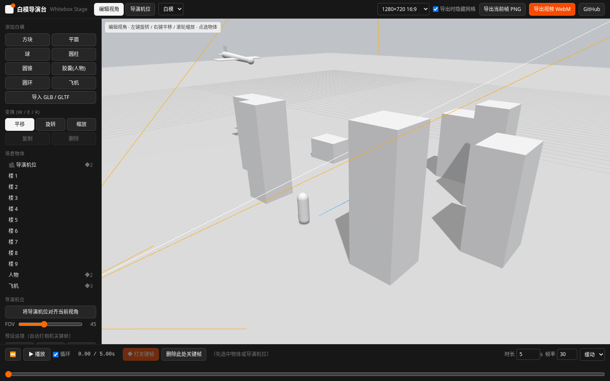
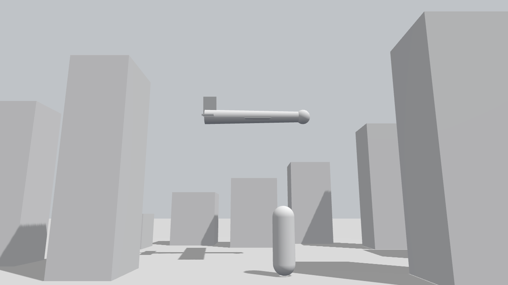
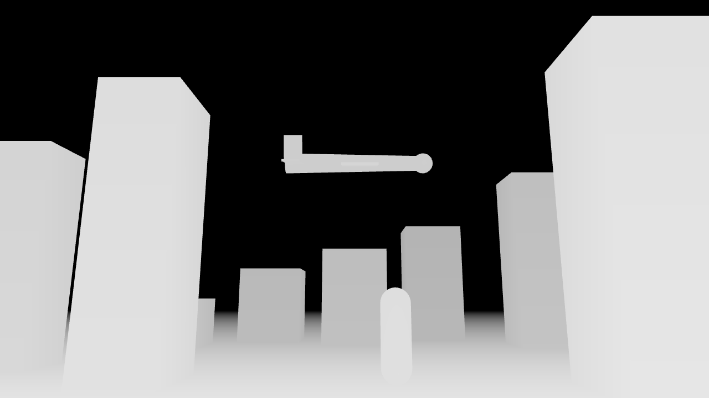

# 白模导演台 Whitebox Stage

> 用 Three.js 在浏览器里摆白模、打关键帧、排镜头，一键导出**白模参考视频 / 参考帧**，喂给 AI 视频模型做镜头与运动参考。
> A browser-based whitebox previs stage: block out scenes with untextured clay models, keyframe camera & object motion, and export reference videos/frames for AI video models.

**在线使用 / Live demo:** https://whitebox-stage.vercel.app



| 白模参考帧 clay | 深度图 depth |
|---|---|
|  |  |

[中文](#中文) · [English](#english)

---

## 中文

### 这是干嘛的

AI 视频模型（Seedance、Kling、Runway、Wan、Stable Diffusion 系视频模型等）光靠文字提示词，很难精确控制「飞机从左上掠过、镜头同时缓慢推近」这种运镜和走位。
白模导演台的思路：先在 3D 里用**白模（无贴图的占位几何体）**把构图、物体运动、相机运动排演出来，导出一段干净的白模视频，再把它当作参考（视频转视频 / 运动参考 / 首帧参考 / 深度·法线控制）交给视频模型去「上皮」。

适合：AI 短片 / 广告 / MV 团队做分镜预演（previs），要求镜头可控、可复现、可多人协作的场景。

### 功能

- **3D 视口**：浅灰背景 + 地面网格 + 坐标轴，物体统一白色 clay 材质，带阴影
- **添加白模**：方块、平面、球、圆柱、圆锥、胶囊（人物占位）、圆环；支持导入 `.glb / .gltf`（自动替换成白模材质）；复制、删除
- **变换**：点选物体，平移 / 旋转 / 缩放（快捷键 W / E / R）
- **关键帧动画**：物体和「导演机位」都能打关键帧（位置 / 朝向 / 缩放 / 相机 FOV），线性或缓动插值；底部时间轴可拖拽预览、播放 / 暂停（空格）、循环
- **两种视角**：编辑视角（自由环绕）/ 导演机位（就是最终导出的镜头），可一键「把导演机位对齐当前视角」
- **预设运镜**：推镜、拉镜、环绕、横移、升降，自动生成相机关键帧
- **渲染模式**：白模 / 线框 / 法线 / 深度 —— 法线和深度图可直接当 ControlNet 类控制信号
- **导出**：逐帧确定性录制 WebM 参考视频（1280×720 / 1920×1080 / 720×1280 竖屏 / 1024×1024），导出当前帧 PNG；导出时可隐藏网格和辅助线
- **场景存档**：场景导出 / 导入 JSON（含关键帧和导入的模型），方便团队共享同一个镜头
- 启动自带示例场景：飞机掠过城市 + 推镜

### 怎么用

1. 左侧「添加白模」摆物体；或「导入 GLB」放进角色 / 载具模型
2. 选中物体，用 W/E/R 调位置、角度、大小
3. 拖时间轴到某个时间点 → 摆好姿态 → 点「打关键帧」；重复几次就有了运动
4. 切到「导演机位」，选中相机打关键帧，或直接用「预设运镜」
5. 播放检查 → 选分辨率 → 「导出视频 WebM」或「导出当前帧 PNG」

### 怎么把导出物喂给视频模型

| 用法 | 喂什么 | 说明 |
|---|---|---|
| 视频转视频 / 运动参考 | 白模 WebM | 在支持参考视频的模型里上传，提示词描述最终质感（如「写实，黄昏，一架银色客机掠过东京高楼」），重绘强度调中等，保留构图与运镜 |
| 首帧 / 首尾帧 | 导出的 PNG | 先用图像模型（SD / Flux 等 + ControlNet depth/normal）把白模帧渲成成品首帧，再作为图生视频的首帧 |
| 深度 / 法线控制 | 切到「深度」「法线」模式再导出 | 作为 ControlNet / 控制视频输入，约束空间结构 |

小贴士：
- 视频长度、帧率、比例尽量和目标模型的输出规格一致（例如 5 秒、24/30fps、16:9 或 9:16）
- 很多平台不收 WebM，可以先转 MP4：`ffmpeg -i whitebox.webm -c:v libx264 -pix_fmt yuv420p whitebox.mp4`
- 录制按实时节奏逐帧进行；如果电脑渲染跟不上（例如无独显、超大场景），WebM 时长会比时间轴略长，可用 `ffmpeg -i in.webm -vf "setpts=N/30/TB" -r 30 -c:v libx264 -pix_fmt yuv420p out.mp4` 按帧数重排为准确时长（30 换成你的帧率）
- 各模型对参考视频的支持方式和参数名不同，以对应平台文档为准

### 本地运行

```bash
git clone https://github.com/Lniosy/whitebox-stage.git
cd whitebox-stage
npm install
npm run dev      # 开发
npm run build    # 产物在 dist/
```

需要 Node.js 18+。导出视频依赖浏览器的 MediaRecorder，推荐 Chrome / Edge。

### 部署

纯静态站点，`dist/` 可以放到任何静态托管：

- **Vercel**：导入仓库即可（Framework 选 Vite，构建命令 `npm run build`，输出目录 `dist`），或 `npx vercel --prod`
- **Netlify / Cloudflare Pages / GitHub Pages**：同样构建命令 + `dist` 目录

---

## English

### What is it

Text prompts alone can't precisely control camera moves and blocking in AI video models (Seedance, Kling, Runway, Wan, SD-family video models…). Whitebox Stage lets you **block out the shot in 3D with untextured clay models**, keyframe objects and a director camera, then export a clean reference video / frame to drive the video model (video-to-video, motion reference, first-frame, depth/normal control).

Built for AI film / ad / MV teams doing previs that must be controllable and reproducible.

### Features

- 3D viewport with ground grid, axes, clay material and shadows
- Primitives: box, plane, sphere, cylinder, cone, capsule (character proxy), torus; import `.glb/.gltf` (auto clay material); duplicate / delete
- Translate / rotate / scale gizmo (W / E / R)
- Keyframes for objects and the director camera (position, rotation, scale, FOV), linear or eased; scrubbable timeline, play/pause (Space), loop
- Editor view vs. director camera view; snap director camera to current view
- Camera presets: dolly in/out, orbit, truck, crane
- Render modes: clay / wireframe / normal / depth
- Export: deterministic frame-by-frame WebM (1280×720, 1920×1080, 720×1280, 1024×1024), current frame PNG; hide helpers on export
- Save / load scene as JSON (incl. keyframes and imported models)
- Demo scene on startup (plane fly-by + dolly in)

### Feeding exports to video models

- **Video-to-video / motion reference**: upload the WebM, describe the final look in the prompt, use medium denoise strength to keep layout and camera motion.
- **First frame**: render the PNG into a finished frame with an image model (+ ControlNet depth/normal), then use it as the image-to-video first frame.
- **Depth / normal control**: switch render mode and export as control input.
- Many platforms don't accept WebM: `ffmpeg -i whitebox.webm -c:v libx264 -pix_fmt yuv420p whitebox.mp4`.
- Recording is paced in real time; on slow GPUs the WebM can run longer than the timeline. Re-time it by frame count: `ffmpeg -i in.webm -vf "setpts=N/30/TB" -r 30 -c:v libx264 -pix_fmt yuv420p out.mp4`.
- Support and parameter names vary by platform; check each model's docs.

### Run locally

```bash
git clone https://github.com/Lniosy/whitebox-stage.git
cd whitebox-stage && npm install
npm run dev
npm run build   # output in dist/
```

Node.js 18+. Video export uses MediaRecorder (Chrome / Edge recommended).

### Deploy

Static site — deploy `dist/` anywhere. Vercel: import the repo (Vite preset) or `npx vercel --prod`.

## License

MIT © Lniosy. Inspired by the "Three.js as a whitebox director's stage" idea shared by [@cellinlab](https://x.com/cellinlab).
